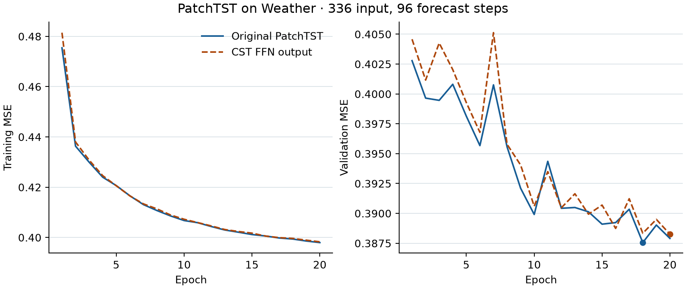

# Weather向け CST PatchTST

[English](README.md) | 日本語

気象観測所の21項目を対象に、直近336点から先96点を予測するPatchTSTを一から学習します。
10分間隔では約56時間の履歴から約16時間先までの予測に相当します。

[PatchTSTのWeather設定](https://github.com/yuqinie98/PatchTST/blob/204c21efe0b39603ad6e2ca640ef5896646ab1a9/PatchTST_supervised/scripts/PatchTST/weather.sh)
はエンコーダ3層、幅128、FFN幅256です。CST版では各FFNの出力射影256→128を、
固定の二次元グリッド上の512 Atomで表現し、バイアスを引き継ぎます。グリッドは潜在特徴の
インデックスに対応します。Attention、共有予測ヘッド、正規化、FFNの残りの処理は
公式アーキテクチャを使います。

RTX 4090で1シード、バッチ64、各20エポックで比較します。通常パラメータの基準学習率は
0.0001、Atomは0.00048で、公式設定のtype-3減衰係数を使います。時系列順の分割を使い、
学習範囲で算出した統計量で各項目を標準化します。標準化空間のMSEとMAEを報告し、
検証MSEが最小のチェックポイントでテスト評価します。

| モデル | テストMSE | テストMAE | 学習パラメータ数 | 1ステップ |
| --- | ---: | ---: | ---: | ---: |
| 元版 | 0.15022 | 0.19772 | 921,187 | 26.15 ms |
| CST版 | 0.14972 | 0.19765 | 832,099 | 31.16 ms |

今回の1シードではテスト誤差はほぼ同等でした。学習パラメータ数は9.7%減り、
学習ステップ時間の中央値は19.2%延びました。



[実験集計](results/summary.json) · [エポック履歴](results/history.csv)

## 推論

[Hugging Faceの重み](https://huggingface.co/takumiecd/cst-patchtst-weather)は
同条件で再学習し、検証MSEで選んだチェックポイントです。以下の例は気温（℃）の
96時点の予測と実測値を返します。同じ21項目を含む独自のCSVを使う場合は
`--test-index` を省くと、直近336行から先を予測します。

```bash
python -m pip install -r requirements.txt
python infer.py data/weather.csv --variant cst --test-index 0
```

元版との比較は `--variant baseline`、CUDA対応環境でGPUを使う場合は
`--device cuda` を指定します。

## 実行

CUDA対応のPyTorch環境を用意します。`weather.csv` は
[PatchTST著者が案内するベンチマークデータ](https://github.com/yuqinie98/PatchTST/blob/204c21efe0b39603ad6e2ca640ef5896646ab1a9/README.md)
から入手できます。実験では52,696行の[Weather CSVミラー](https://www.uni-hildesheim.de/gitlab/domuro/PatchTST/-/blob/f720f50a210751dfbfb84c6008c19dd2cf6d8d44/PatchTST_self_supervised/dataset/weather.csv)
を使いました。SHA-256は `9b2b19b13e342d9c9b9c51620d42b4be232df7fba30e7f5c4968b7c79ab138ad`
です。時刻が同じ行の組が1箇所、100分間の空白が1箇所あり、元ファイルの行をそのまま使います。

```bash
python -m pip install -r requirements.txt
for variant in baseline cst; do
  OMP_NUM_THREADS=2 MKL_NUM_THREADS=2 python train.py --variant "$variant" \
    --data data/weather.csv --output "output/weather/$variant" \
    --batch-size 64 --seed 2021 --epochs 20 --atoms 512 --atom-lr 0.00048
done
```

新しい出力先で `--pilot 25` を指定すると、8回のウォームアップ後に25回の学習更新を
計測します。同梱したアーキテクチャの権利表記は[公式ライセンス](upstream/LICENSE)に従います。

学習した重みは `python export.py --run output/weather --output output/weights` で
書き出せます。
